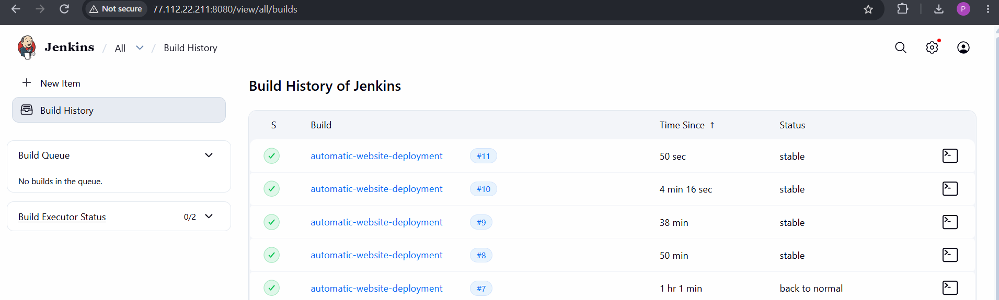
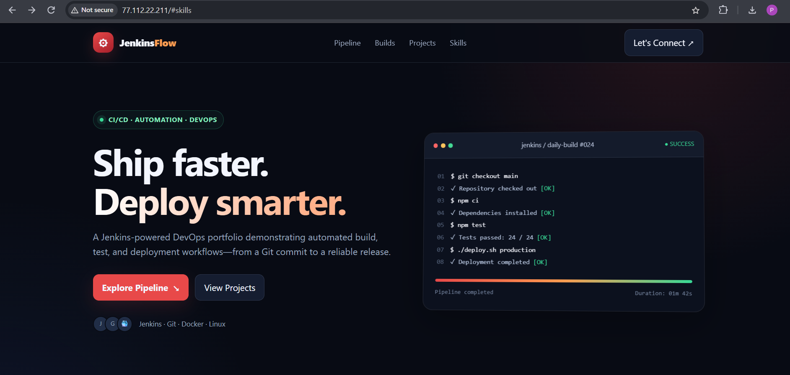
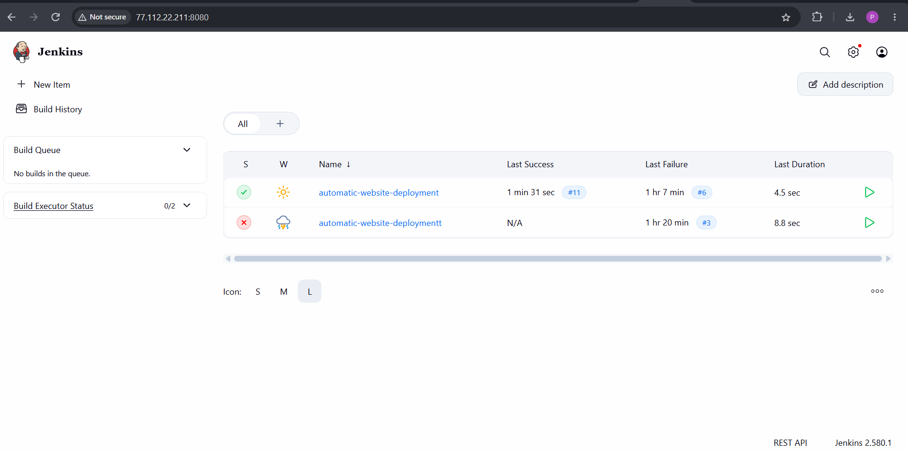

# JenkinsFlow — Automatic Website Deployment with Jenkins

A DevOps mini-project demonstrating a Jenkins CI/CD pipeline for deploying a static website to an AWS EC2 Ubuntu server, with Nginx serving the deployed files.

## Screenshots

### Jenkins Build History


### JenkinsFlow Portfolio Website


### Jenkins Dashboard and Pipeline Jobs


## Architecture

```text
Developer --git push--> GitHub Repository
                            |
                     GitHub Webhook*
                            |
                            v
                    Jenkins Pipeline
                     1. Checkout
                     2. Validate
                     3. Deploy
                            |
                            v
                  /var/www/jenkins-site
                            |
                            v
                      Nginx (port 80)
                            |
                            v
                      Website visitors
```

*Webhook triggering works only when the GitHub webhook and Jenkins trigger are configured and verified.

## Technologies Used

- Jenkins — CI/CD automation
- Git and GitHub — source control
- GitHub Webhooks — automatic trigger after a push (optional/configuration-dependent)
- AWS EC2 — cloud virtual machine
- Ubuntu Linux — operating system
- Nginx — web server
- HTML and CSS — website frontend
- Shell scripting — validation and deployment

## Pipeline Stages

1. **Checkout:** fetches the latest source code from the configured repository.
2. **Validate:** checks that `index.html` and `style.css` exist and verifies that `index.html` contains an HTML tag.
3. **Deploy:** syncs website files to `/var/www/jenkins-site`.
4. **Verify:** checks that the deployed index file exists and that Nginx responds locally.

## Repository Structure

```text
.
├── index.html
├── style.css
├── Jenkinsfile
├── README.md
└── screenshots/
    ├── jenkins-build-history.png
    ├── jenkinsflow-website.png
    └── jenkins-dashboard.png
```

## Setup Overview

### Prerequisites

- AWS EC2 Ubuntu instance
- Jenkins installed and running
- Git and `rsync` available on the Jenkins agent
- Nginx configured to serve `/var/www/jenkins-site`
- Repository containing `index.html`, `style.css`, and `Jenkinsfile`

### 1. Prepare the web root

On the EC2 instance, if Jenkins runs locally as the `jenkins` user

Adjust ownership and permissions to match your Jenkins agent and security requirements.

### 2. Configure Nginx

Validate and reload Nginx:

```bash
sudo nginx -t
sudo systemctl reload nginx
```

### 3. Configure the Jenkins job

Create a **Pipeline** job and choose **Pipeline script from SCM**:

- SCM: Git
- Repository URL: your GitHub repository URL
- Branch: `*/main` (or the branch used by your repository)
- Script Path: `Jenkinsfile`

To use GitHub webhooks, configure a webhook in the GitHub repository and enable the matching webhook trigger in Jenkins. Test it with a harmless commit and confirm a new build appears in Build History.

### 4. Run and verify

- Run the Jenkins pipeline.
- Open the build's **Console Output** and verify each stage.
- Visit the website using your EC2 public IP/DNS if port 80 is intentionally accessible.
- Push a small commit to test webhook triggering, if configured.

## Security Notes

- Never commit AWS access keys, private keys, passwords, Jenkins secrets, or `.env` files.
- Do not expose Jenkins port `8080` to the whole internet. Restrict access to your IP or use a secure VPN/reverse proxy with HTTPS.
- Use least-privilege IAM permissions and review EC2 Security Group rules.
- Enable HTTPS for a public website where appropriate.

## What I Learned

- Writing a declarative Jenkins pipeline using a `Jenkinsfile`
- Integrating Jenkins with GitHub
- Understanding CI/CD and webhook-triggered builds
- Deploying static files to an Nginx web root
- Troubleshooting build failures and Linux permissions
- Verifying deployments with Jenkins Console Output

## Future Improvements

- Add HTML/CSS linting and automated tests
- Add build notifications
- Configure HTTPS with a domain name
- Add versioned releases and rollback
- Store secrets in Jenkins Credentials
- Add a staging environment

## Author

**Prince Vaghasiya**

Repository: [jenkins-automatic-website-deployment](https://github.com/Prince16605/jenkins-automatic-website-deployment)

---

If you find this project useful, please consider starring the repository.
